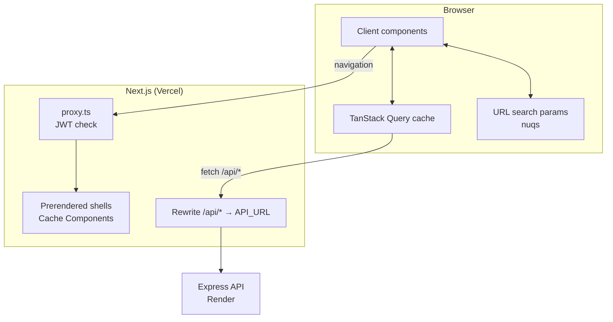
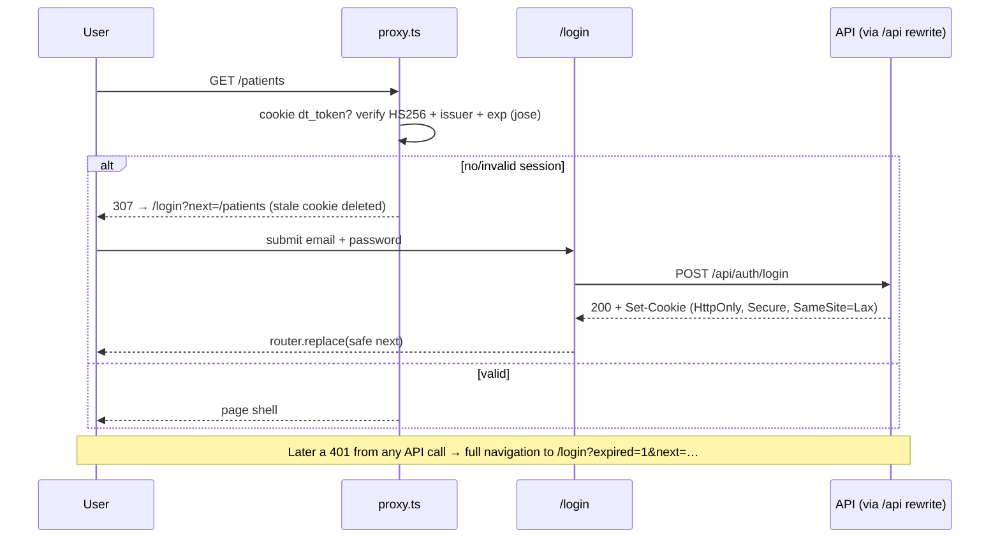

# Architecture — Doctor Tracker Frontend

How the Next.js application is structured and why. For setup and screenshots see [README.md](./README.md); for the API side see the [backend architecture](https://github.com/sadatnuman/doctor-tracker-backend/blob/main/ARCHITECTURE.md).

- [1. Overview](#1-overview)
- [2. Rendering strategy](#2-rendering-strategy)
- [3. Authentication flow](#3-authentication-flow)
- [4. State model](#4-state-model)
- [5. Data fetching & caching](#5-data-fetching--caching)
- [6. Component architecture](#6-component-architecture)
- [7. Forms & validation](#7-forms--validation)
- [8. Performance](#8-performance)
- [9. Data visualization](#9-data-visualization)
- [10. Design system](#10-design-system)
- [11. Responsive design & accessibility](#11-responsive-design--accessibility)
- [12. Error handling & resilience](#12-error-handling--resilience)
- [13. Deployment](#13-deployment)

---

## 1. Overview



The frontend is a **separate application** from the API. It owns presentation, routing, session gating and client-side caching; all data and business rules live behind the REST API.

## 2. Rendering strategy

Next.js 16 with **Cache Components** (`cacheComponents: true`):

| Route | Render mode | Why |
|---|---|---|
| `/login`, `/`, `/doctors`, `/patients` | **Static** (prerendered shell) | Page chrome is identical for every admin; data is fetched client-side with caching. |
| `/doctors/[id]` | **Partial prerender** | Static shell; the parts that read request data (route params, pathname) stream in under `<Suspense>`. |

- Page files are tiny **Server Components** that render a `<Suspense>` boundary around one client "view" component (`DoctorsView`, `PatientsView`, `DashboardView`, `DoctorDetailView`). The fallback is a skeleton shaped like the final content, so layout doesn't shift.
- Anything that reads request-time data (`useSearchParams` via nuqs, `usePathname` for the active nav item, `useParams`) sits inside a Suspense boundary, which is what lets the rest of the page prerender. The sidebar renders its links immediately and highlights the active one once the pathname streams in.
- Why client-side data instead of server-fetched data: every list is driven by interactive filters that change many times per minute. Fetching in the browser with a shared query cache gives instant back/forward, cached pages, background refetch and optimistic updates, without a server round trip per filter change.

## 3. Authentication flow



- `proxy.ts` (formerly "middleware") runs on every page request except `/api`, static assets and icons. It is an **optimistic check** for UX; the API re-verifies every request.
- `?next=` is accepted only when it is a same-site relative path (starts with `/` but not `//`), preventing open redirects.
- Sign-out calls `POST /api/auth/logout`, clears the whole query cache and replaces the route, so no data from the previous session stays in memory.

## 4. State model

| Kind of state | Where it lives | Examples |
|---|---|---|
| Server state | TanStack Query cache | doctor lists, a doctor's profile, patients, dashboard overview, filter options, current user |
| View / navigation state | URL search params (nuqs) | `page`, `limit`, `search`, `specialization`, `condition=Asthma,Diabetes`, `from`, `to`, `sort`, dashboard `range` |
| Ephemeral UI state | `useState` in the owning component | which dialog is open, which row is being edited or deleted, password visibility |
| Form state | react-hook-form | create / edit doctor and patient forms |
| Preferences | `next-themes` (localStorage) | light / dark theme |

There is deliberately **no global store**. The reasoning (and the comparison with Redux / Context) is in the README's *Technical decisions*.

URL state details:

- Parsers are typed and defaulted in one place (`src/lib/search-params.ts`), so invalid params (`?sort=hack`) fall back to defaults instead of reaching the API.
- Updates use `history: "replace"` so typing in filters doesn't flood the history stack; every filter change also resets `page` to 1.
- Date filters are stored as UTC calendar dates and converted to and from local dates at the calendar boundary, so a filter never shifts by a day across timezones.

## 5. Data fetching & caching

`src/lib/api.ts` is a ~100-line typed `fetch` wrapper:

- Calls same-origin `/api/*` with `credentials: "same-origin"`; serializes params (arrays → comma-separated, `Date` → ISO, empty values dropped).
- Normalizes failures into an `ApiError { status, code, message, details }`, including network failures (status 0) and non-JSON responses.
- On **401** (session expired mid-use) it performs a full navigation to `/login?expired=1&next=<current page>`.

Hooks in `src/hooks/` wrap each endpoint. Query keys are hierarchical (`src/lib/query-keys.ts`):

```
['doctors', 'list', params]     ['doctors', 'detail', id]     ['doctors', 'options', search]
['patients', 'list', params]    ['stats', 'overview', params] ['meta', 'filters']   ['auth', 'me']
```

Caching rules:

- **Defaults:** `staleTime` 30 s, no refetch on window focus, retry only transient failures (never 4xx), at most twice.
- **Pagination without flicker:** list queries return the previous page as `placeholderData` while the next loads; the table dims slightly (`isPlaceholderData`) instead of flashing a skeleton.
- **Cancellation:** every `queryFn` forwards TanStack's `AbortSignal`, so a superseded search request is aborted.
- **Stable keys:** request params are memoized; the dashboard rounds its `from` date to the day so its key (and cache hit) is stable all day.
- **Targeted invalidation:** creating a patient invalidates `patients`, `doctors` (patient counts) and `stats`; editing a doctor patches its cached profile in place and invalidates the lists that embed its name.
- **Optimistic delete:** deleting a patient removes the row from every cached patient page immediately, snapshotting first; on error the snapshot is restored, and on settle the affected families refetch.
- **Error surfacing:** a global `MutationCache.onError` toasts failures, except for mutations marked `meta.silent` (forms), which map errors onto fields instead.

## 6. Component architecture

```
components/
├─ ui/          shadcn/ui primitives (Radix): button, dialog, select, sheet, table, sidebar, chart …
├─ data/        list building blocks, domain-agnostic
│   SearchInput · FilterBar · FilterSelect · MultiFilter · DateRangeFilter · SortSelect · Pagination · TableSkeleton
├─ common/      shared domain-flavoured pieces
│   PageHeader · PersonCell · StatusBadge / ConditionTag · StatusBand · ConfirmDialog · EmptyState / ErrorState · FormField
├─ layout/      AppSidebar · SiteHeader · UserMenu · ServerWakeNotice
├─ doctors/     DoctorsView · DoctorDetailView · DoctorFormDialog · DoctorPicker · DeleteDoctorDialog · DoctorRowActions
├─ patients/    PatientList · PatientsView · PatientFormDialog
└─ dashboard/   DashboardView · ChartPanel · charts (lazy)
```

Reuse examples:

- **`PatientList`** is one component used by both the Patients page and the doctor profile. Given a `doctor` prop it scopes to that doctor: it uses the nested REST route, hides the doctor filter and column, pre-fills the doctor in the "Add patient" form, and switches delete wording to "Remove from this doctor's list".
- **`FilterBar`** takes `search` and `filters` slots and renders them inline on desktop or inside a bottom sheet (with an active-filter count badge) on mobile.
- **`DoctorPicker`** is a server-searched combobox (debounced, 20 results) used both as a filter (with "All doctors") and as a form field, so it scales to any roster size where a static `<select>` would not.
- **`ChartPanel`** wraps every chart with a title, description and a Chart/Table toggle.

## 7. Forms & validation

- **react-hook-form** with uncontrolled inputs, so typing doesn't re-render the whole form; selects and toggles use `Controller`.
- **Zod schemas** in `src/lib/validators.ts` mirror the API's rules (lengths, phone format, enum values, no future admission dates), giving instant feedback. A ~20-line custom resolver (`src/lib/zod-resolver.ts`) connects Zod 4 to react-hook-form without the `@hookform/resolvers` dependency tree.
- **The API stays the source of truth:** `applyServerErrors` maps the API's `details: [{ field, message }]` (400) and duplicate-key conflicts (409, e.g. a doctor email already in use) onto the matching fields.
- **Edit forms PATCH only dirty fields**, and the submit button stays disabled until something changes.
- Accessibility: every control has a `<label>`, errors are linked with `aria-describedby` and announced (`role="alert"`), and invalid fields set `aria-invalid`.

## 8. Performance

| Technique | Where |
|---|---|
| Static prerendering of every page shell | Cache Components; only `/doctors/[id]` streams a dynamic part |
| Code-splitting the charting library | `next/dynamic(..., { ssr: false })` for all Recharts code; Doctors and Patients bundles never include it |
| Tree-shaken barrel imports | `optimizePackageImports` for lucide-react, recharts, date-fns, radix-ui |
| Debounced search | keystrokes stay local; one URL commit (and one request) after 300 ms idle |
| Memoized rows and cells | `React.memo` on `DoctorRow`, `DoctorCard`, `PatientRow`, `PatientCard`, `StatusBadge`, `PersonCell`, `Pagination`; row callbacks are `useCallback`-stable, so opening a dialog or paging doesn't re-render unchanged rows |
| No effect-driven state | `useIsMobile` and `usePrefersReducedMotion` use `useSyncExternalStore`; the search box adjusts state during render instead of in effects (enforced by the React Hooks lint rules) |
| Request efficiency | de-duplication, abort on change, cached pages, `placeholderData`, targeted invalidation |
| Fonts | `next/font` self-hosting with `display: swap` |

## 9. Data visualization

The dashboard (`/stats/overview`) is built so each chart answers a question:

| Question | Form | Encoding |
|---|---|---|
| Is demand growing? | Area "monitor trace" over ECG-style chart paper | single teal series, crosshair tooltip, busiest-period callout, % change vs previous period |
| Who is overloaded? | Ranked horizontal bars (top 10) | single hue, value labels, tooltip with critical count, bars link to the doctor |
| What are patients admitted with? | Ranked horizontal bars | single hue, value labels |
| Where do admissions stand now? | Proportional status band | reserved triage colours **plus** a labelled legend with counts and percentages |
| Who are the patients? | Age-group columns + gender split as text | single hue; gender shown as figures rather than a third categorical palette |
| How is the roster composed? | Ranked horizontal bars by specialization | single hue |

Rules applied:

- **Colour carries meaning, never decoration.** Magnitude charts all use one hue. Status colours (Critical red, Active blue, Recovered green, Discharged slate) are reserved for status only, ordered by severity so red never sits next to green, and every status mark has a text label beside it.
- The status palette was checked with a colour-vision-deficiency validator in both light and dark modes; dark mode has its own tuned values rather than an automatic inversion.
- Every chart has a **table view** and an `aria-label`ed container, so no insight depends on seeing colour or shape.
- Animation: one orchestrated moment (the admissions trace draws itself once on load); Recharts animations and the trace are disabled under `prefers-reduced-motion`.

## 10. Design system

Tokens are CSS variables in `src/app/globals.css`, exposed to Tailwind via `@theme`, with separate light and dark values:

| Token | Light | Role |
|---|---|---|
| scrub ink | `#0F2A3D` | text, sidebar |
| teal | `#0E7C7B` | primary actions, data series |
| paper | `#F5F8F9` | canvas (cool clinical white) |
| line | `#DAE2E7` | hairlines, chart-paper grid |
| triage | `#D64545` / `#2F6FDE` / `#2E9D6A` / `#5F6B77` | Critical / Active / Recovered / Discharged |

Typography: **Bricolage Grotesque** for headings and key figures, **Public Sans** (an institutional, signage-like face) for UI text, tabular figures for every number. Status badges are styled like patient wristbands: a tinted band with a solid colour stripe.

## 11. Responsive design & accessibility

- Breakpoint at 768 px: the sidebar becomes an off-canvas drawer, tables become stacked cards with the most important fields first, filters move into a bottom sheet, the date picker shows one month instead of two, and the page-size and sort controls compact.
- Sticky translucent header; the content width is capped for readable line lengths on wide screens.
- Radix primitives provide focus trapping, keyboard navigation and ARIA roles for dialogs, menus, selects and comboboxes; every icon-only button has an `aria-label`; the active nav item sets `aria-current="page"`; the pagination summary is a polite live region.
- Visible focus rings, semantic headings, `prefers-reduced-motion` respected, and a light/dark theme toggle.

## 12. Error handling & resilience

| Situation | What the user sees |
|---|---|
| List or chart request fails | Inline error state with the API's message and a **Try again** button |
| Form validation error from the API | Message under the specific field |
| Other mutation failure | Toast with the API's message |
| Session expired | Redirect to sign-in with "Your session ended. Sign in again to continue." and return to the same page afterwards |
| Unknown doctor id | "This doctor isn't on the roster" with a link back |
| Render cold start (free tier) | "Waking the server…" notice in the header if any request takes longer than 4 s |
| Unexpected render error | Route-level `error.tsx` boundary with retry |
| Unknown route | Branded 404 page |

## 13. Deployment

- **Vercel** project tracking `main`; preview deployments for other branches.
- Environment: `API_URL` (Render URL, used by the rewrite) and `JWT_SECRET` (shared with the API, used by `proxy.ts`), plus the optional demo-credential variables.
- Security headers set in `next.config.ts`: `X-Content-Type-Options: nosniff`, `X-Frame-Options: DENY`, `Referrer-Policy: strict-origin-when-cross-origin`; `poweredByHeader` disabled; pages are marked `noindex`.
