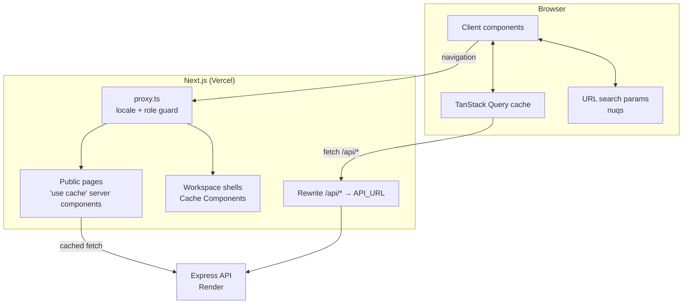
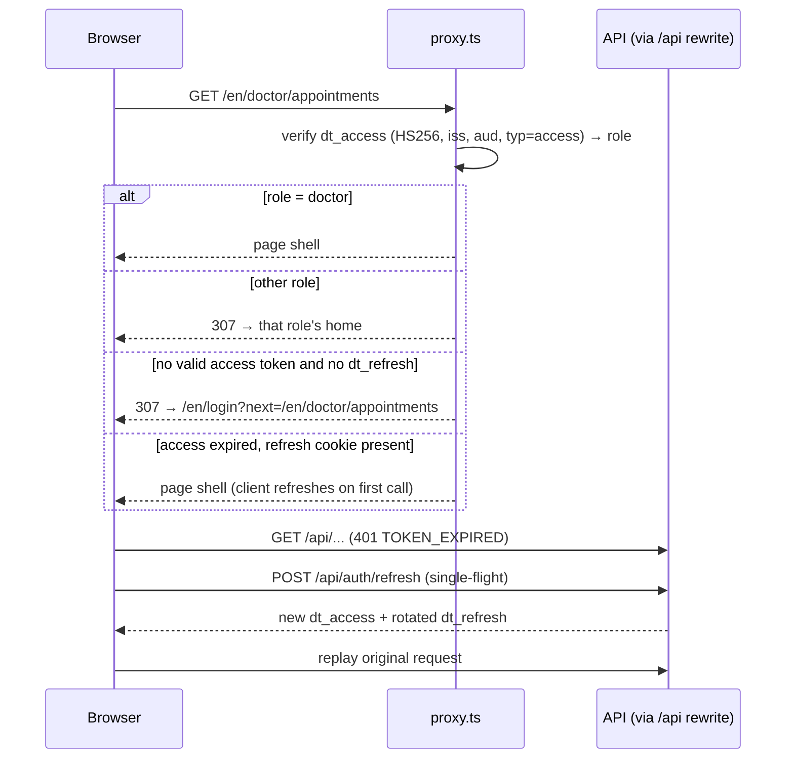
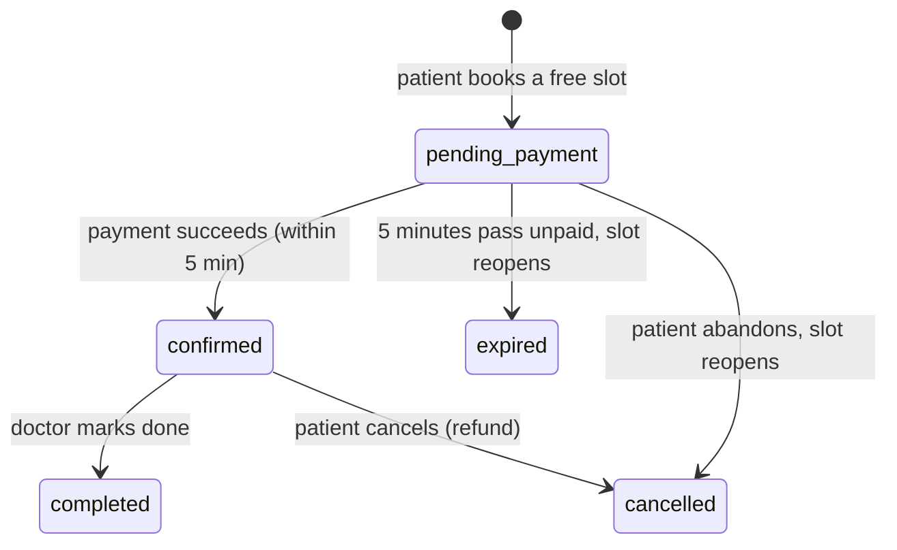

# Architecture: Doctor Tracker Frontend

How the Next.js application is structured and why. Setup and screenshots are in [README.md](./README.md). The API side is in the [backend architecture](https://github.com/sadatnuman/doctor-tracker-backend/blob/main/ARCHITECTURE.md).

- [1. Overview](#1-overview)
- [2. Routes and roles](#2-routes-and-roles)
- [3. Rendering strategy](#3-rendering-strategy)
- [4. Internationalization (English / বাংলা)](#4-internationalization-english--বাংলা)
- [5. Technical SEO](#5-technical-seo)
- [6. Sessions and route protection](#6-sessions-and-route-protection)
- [7. Booking and payment flow](#7-booking-and-payment-flow)
- [8. State model](#8-state-model)
- [9. Data fetching and caching](#9-data-fetching-and-caching)
- [10. Component architecture](#10-component-architecture)
- [11. Forms and validation](#11-forms-and-validation)
- [12. Profile pictures](#12-profile-pictures)
- [13. Performance](#13-performance)
- [14. Data visualization](#14-data-visualization)
- [15. Design system](#15-design-system)
- [16. Responsive design and accessibility](#16-responsive-design-and-accessibility)
- [17. Error handling and resilience](#17-error-handling-and-resilience)
- [18. Deployment](#18-deployment)
- [19. Testing](#19-testing)

---

## 1. Overview



The frontend is a **separate application** from the API. It owns presentation, routing, localization, SEO, session gating and client-side caching. All data and business rules sit behind the REST API: who may see what, slot holds, and payment.

## 2. Routes and roles

Every route sits under `/[lang]` (`en` or `bn`).

| Area | Paths | Who | Notes |
|---|---|---|---|
| Public | `/`, `/doctors`, `/doctors/[id]`, `/specialties/[slug]` | everyone | Indexed by search engines. Booking starts here. |
| Auth | `/login`, `/register` | signed-out | One sign-in page for all roles. Registration creates **patient** accounts only. |
| Patient | `/account`, `/account/appointments/[id]`, `/account/profile` | `patient` | Public site navigation plus account tabs. |
| Doctor | `/doctor`, `/doctor/appointments`, `/doctor/patients`, `/doctor/schedule`, `/doctor/profile` | `doctor` | Sidebar workspace scoped to the signed-in doctor. |
| Admin | `/admin`, `/admin/doctors`, `/admin/doctors/[id]`, `/admin/patients`, `/admin/appointments`, `/admin/profile` | `admin` | Sidebar workspace over all data. |

After sign-in each role lands on its own home (`ROLE_HOME`): `/admin`, `/doctor` or `/account`. Doctor accounts are created by an admin, who sets the initial password on the doctor's profile. Patients only need an account when they book.

## 3. Rendering strategy

Next.js 16 with **Cache Components** (`cacheComponents: true`, Partial Prerendering):

| Route | Render mode | Why |
|---|---|---|
| Landing, directory | Prerendered, revalidated (`'use cache'` + `cacheLife("minutes")`) | Real HTML for crawlers, with fresh-enough data. |
| `/specialties/[slug]` | **Static** (`generateStaticParams`: 12 specialties × 2 languages) | Keyword landing pages, built once. |
| `/doctors/[id]` | Static shell + streamed profile | `currentLocale()` reads the language from `next/root-params`, so the shell prerenders without awaiting the unknown id. The profile streams in under `<Suspense>` and then stays cached. |
| Workspaces, auth pages | Static shell + client view | Data depends on the session and on interactive filters, so it's fetched in the browser. |

- Workspace page files are tiny **Server Components**. Each renders a `<Suspense>` boundary around one client "view" component, and the fallback is a skeleton shaped like the final content, so the layout doesn't shift.
- Anything that reads request-time data (`useSearchParams` via nuqs, `usePathname`, `useParams`) sits inside a Suspense boundary, which lets the rest of the page prerender.
- Server-side fetchers (`src/lib/server-api.ts`) choose their cache lifetime **after** the request:
  - A successful response is cached for minutes or hours.
  - A failure, such as the API cold-starting, is cached for seconds only, so an error never sticks.
  - An unknown or malformed doctor id returns a real 404.

## 4. Internationalization (English / বাংলা)

- **Routing.** `src/i18n/config.ts` defines `LOCALES = ["en", "bn"]`. `proxy.ts` redirects un-prefixed paths using the `NEXT_LOCALE` cookie, then `Accept-Language`, then English. The language switcher swaps the prefix in place and keeps the query string.
- **Dictionaries.** `dictionaries/en.ts` is the source of truth and exports the `Dictionary` type. `bn.ts` is typed `Dictionary`, so a missing Bangla string fails the build. The server gets dictionaries through `getDictionary(locale)`, a dynamic import per language. Client components get them through `useI18n()` → `{ locale, d, tr, href, f }`.
- **Formatting.** `createFormatters(locale)` wraps `Intl`:
  - Numbers, compact numbers, money (৳ BDT), dates, date-times and slot times.
  - Formatting uses `bn-BD` for Bangla, which also gives Bengali digits.
  - Slot times always display in **Asia/Dhaka**, whatever timezone the device is in.
- **Errors and validation.** API error codes map to localized messages (`localizeError`). Zod schemas are built from factories that take `d.validation`, so form errors appear in the active language.
- **Type.** Inter is used for Latin text. Noto Sans Bengali supplies the Bangla glyphs Inter lacks, and it isn't preloaded on English pages. `<html lang>` is `en` or `bn`.

## 5. Technical SEO

| Item | Implementation |
|---|---|
| Titles and descriptions | `generateMetadata` on every public page. Doctor and specialty pages interpolate name, specialty, hospital and fee in the page's language. |
| Canonical + hreflang | `alternatesFor(locale, path)` gives a canonical for the current language plus `en`, `bn-BD` and `x-default` alternates. |
| Open Graph | Localized `og:locale`, title, description and URL. Doctor pages use the doctor's photo when they have one. |
| Structured data | Layout: `WebSite` (with `SearchAction` into the directory) and `MedicalOrganization`. Landing: `FAQPage`. Doctor: `Physician` (specialty, fee, accepted payments, hospital affiliation, `openingHoursSpecification`) and `BreadcrumbList`. Specialty: `BreadcrumbList`. |
| H1 structure | One H1 per page, followed by an ordered H2/H3 outline. A skip link jumps to `#main`. |
| `sitemap.xml` | `src/app/sitemap.ts` covers the landing page, directory, 12 specialties and every doctor, in both languages, each with `alternates.languages`. |
| `robots.txt` | Allows the public site. Disallows `/api/`, the workspaces (`/admin`, `/doctor`, `/account`) and auth pages, and points to the sitemap. |
| Private pages | `privatePageMetadata()` gives workspace pages a localized title and `noindex, nofollow`. |
| Keyword targeting | Specialty pages (for example "Cardiology doctors in Bangladesh") have their own copy and doctor lists. Hero search uses a plain GET form, so it works without JavaScript. |
| Internal links | Footer links to all specialties, specialty chips, breadcrumbs, "Other {specialty} doctors" on each profile, and a featured-doctors grid on the landing page. |
| Link previews | `[lang]/opengraph-image.tsx` renders a 1200 × 630 site card. `doctors/[id]/opengraph-image.tsx` renders a card per doctor (name, specialty, hospital, hours, fee), built with `next/og` and self-hosted Inter (`assets/fonts`). Pages that set their own `openGraph` pass the site image explicitly (`siteOgImage`), because a child `openGraph` replaces the inherited one. The cards are drawn in English: the renderer can't shape Bengali vowel signs, while the localized title and description still show beside the image. `twitter:card` is `summary_large_image`. |
| Hosting-ready | `SITE_URL` comes from `NEXT_PUBLIC_SITE_URL`, or Vercel's production URL automatically, so canonical URLs and the sitemap are correct on any free host. |

## 6. Sessions and route protection



- **Two cookies, both httpOnly:**
  - `dt_access`: a 15-minute JWT carrying `role` and, for doctors, `doctorId`.
  - `dt_refresh`: an opaque 7-day token, rotated on every use.
  - A third cookie, `dt_session=1`, is readable by scripts and holds no secret. It only tells the client a session may exist, so visitors never send a pointless `/auth/me` or refresh request.
- **Single-flight refresh.** In `src/lib/api.ts`, concurrent 401s share one refresh promise. If the API answers `REFRESH_RACE` (another tab rotated the token a moment earlier), the client simply retries. If refresh fails, the client navigates to `/{lang}/login?expired=1&next=…`; requests marked `silent` skip this.
- **Two layers of guards.** `proxy.ts` is the optimistic UX layer. Each area layout also wraps content in `<RoleGate role=…>`, which checks `/auth/me`. The **API is the security boundary**: `requireRole`, `requireDoctorScope`, and services that filter by owner, so a doctor gets a 404 for another doctor's patient.
- **Safe redirects.** `?next=` must be a same-site relative path (`/…` but not `//…`). After sign-in, `next` is used only if it belongs to an area the role may enter. Otherwise the user goes to their role's home.
- **Sign-out.** It calls `POST /api/auth/logout` and clears the whole query cache, so nothing from the previous session stays in memory. "Sign out everywhere" bumps the user's `tokenVersion` on the API.

## 7. Booking and payment flow



1. **Pick a slot.** `BookingPanel` shows the next 30 days of the doctor's weekly schedule (`GET /public/doctors/:id/slots`, refetched every minute). Taken or held slots are disabled.
   - A **visitor** is sent to `/login?next=/doctors/:id?slot=<iso>`, and comes back with the same slot selected.
2. **Hold.** `POST /appointments` creates a `pending_payment` appointment with `holdExpiresAt` 5 minutes ahead. The API's partial unique index on `{doctor, start}` (for slot-holding statuses) makes double-booking impossible, even when two patients click at the same moment. The loser gets a `SLOT_TAKEN` conflict, and the slot list refreshes.
3. **Pay.** `/account/appointments/[id]` shows `HoldCountdown`.
   - The countdown is computed against the server's clock: `serverTime` gives the skew, so a wrong device clock can't show extra time.
   - At zero it refetches, and the page switches to "Your hold ran out".
   - `PaymentForm` offers card (Luhn check, expiry, CVC), bKash or Nagad, validated in the browser and again on the API.
   - The simulated gateway on the API declines `4000 0000 0000 0002`. A declined payment keeps the hold, so the patient can retry.
4. **Confirm.** A successful payment flips the appointment to `confirmed`, but only if the hold is still valid. The API records the payment (transaction id, masked instrument) and **adds the patient to the doctor's patient list**. The page becomes a receipt.
5. **Afterwards.**
   - Cancelling a confirmed appointment refunds it.
   - The doctor sees the booking under **Appointments** and can mark it completed.
   - The admin sees everything under **Appointments**, and the dashboard counts bookings and revenue.

Every booking mutation invalidates appointments, slots, the doctor overview, patients and stats together through `useInvalidateBookings()`.

## 8. State model

| Kind of state | Where it lives | Examples |
|---|---|---|
| Server state | TanStack Query cache | lists, profiles, slots, appointments, overview stats, current user |
| View / navigation state | URL search params (nuqs) | `page`, `limit`, `search`, `specialization`, `condition=Asthma,Diabetes`, `from`, `to`, `sort`, `status`, dashboard `range`, `slot` |
| Ephemeral UI state | `useState` in the owning component | open dialog, row being edited, chosen day in the slot picker, password visibility |
| Form state | react-hook-form | doctor, patient, profile, password, schedule and payment forms |
| Preferences | cookie / localStorage | language (`NEXT_LOCALE`), theme (`next-themes`) |

There is deliberately **no global store**. The README's *Technical decisions* explains why, compared with Redux and Context.

- Parsers are typed and given defaults in one place (`src/lib/search-params.ts`), so invalid params such as `?sort=hack` fall back to the defaults instead of reaching the API.
- Filter updates use `history: "replace"`, and every filter change resets `page` to 1.
- Date filters are stored as UTC calendar dates, so a filter never shifts by a day across timezones.

## 9. Data fetching and caching

`src/lib/api.ts` is a small typed `fetch` wrapper:

- Calls same-origin `/api/*`; serializes params (arrays become comma-separated, `Date` becomes ISO, empty values are dropped); supports JSON and raw `Blob` bodies (avatar upload).
- Normalizes failures into `ApiError { status, code, message, details }`, including network failures (status 0) and non-JSON responses.
- Handles token refresh and replay as described in §6.

Query keys are hierarchical (`src/lib/query-keys.ts`):

```
['doctors', 'list', params]   ['doctors', 'detail', id]   ['doctors', 'mine']   ['doctors', 'my-overview']
['patients', 'list', params]  ['appointments', 'list', params]   ['appointments', 'detail', id]
['slots', doctorId]           ['stats', 'overview', params]      ['meta', 'filters']   ['auth', 'me']
```

Caching rules:

- **Defaults.** `staleTime` 30 s and no refetch on window focus. Transient failures are retried at most twice, and 4xx responses never.
- **Pagination without flicker.** `placeholderData: (previous) => previous` keeps the current page on screen while the next loads; the table dims instead of flashing a skeleton.
- **Cancellation.** Every `queryFn` forwards TanStack's `AbortSignal`.
- **Polling, only where it matters.** A booking still waiting for payment refetches every 30 s, and the slot list every 60 s. Settled bookings don't poll.
- **Targeted invalidation.** Creating a patient refreshes patients, doctors (patient counts) and stats. Editing a doctor patches its cached profile in place.
- **Optimistic delete.** Deleting a patient removes the row from every cached page at once. If the request fails, the snapshot is restored.
- **Error surfacing.** A global `MutationCache.onError` shows a localized toast. Mutations marked `meta.silent` (forms) map errors onto fields instead.

## 10. Component architecture

```
components/
├─ ui/            shadcn/ui primitives (Radix)
├─ data/          SearchInput · FilterBar · FilterSelect · MultiFilter · DateRangeFilter · SortSelect · Pagination · TableSkeleton
├─ common/        PasswordInput · UserAvatar · RoleGate · LanguageSwitcher · PageHeader · PersonCell
│                 StatusBadge / AppointmentStatusBadge / ConditionTag · StatusBand · ConfirmDialog · states · FormField
├─ layout/        WorkspaceShell · AppSidebar (per role) · SiteHeader · UserMenu · ServerWakeNotice
├─ public/        SiteNav · SiteFooter · DoctorCard · DoctorDirectory · DirectoryFilters · BookingPanel · AccountTabs
├─ appointments/  AppointmentList (patient | doctor | admin) · HoldCountdown · PaymentForm · AppointmentDetail
├─ doctor-area/   DoctorOverview · MyPatients · MySchedule
├─ profile/       ProfileView · AvatarUploader
├─ doctors/       DoctorsView · DoctorDetailView · DoctorFormDialog · DoctorAccountCard · ScheduleForm · DoctorPicker
├─ patients/      PatientList · PatientsView · PatientFormDialog
└─ dashboard/     DashboardView · ChartPanel · charts (lazy)
```

Reuse examples:

- **`AppointmentList`** serves all three roles through a `mode` prop. Patients see the doctor and can open a booking. Doctors see the patient and can mark a booking complete. Admins see both.
- **`PatientList`** is shared by the admin Patients page, the admin doctor profile and the doctor's own **My patients**. Given a `doctor`, it scopes itself to that doctor, hides the doctor column and pre-fills the add form.
- **`ScheduleForm`** edits weekly availability. Admins use it on a doctor's profile, and doctors use it on their own schedule page.
- **`PasswordInput`** puts a show/hide eye button (with `aria-pressed` and a localized label) on every password field: sign in, register, change password and the doctor's initial password.
- **`FilterBar`** renders filters inline on desktop and in a bottom sheet with an active-filter count on mobile.

## 11. Forms and validation

- **react-hook-form** with uncontrolled inputs, so typing doesn't re-render the whole form.
- **Zod schemas** in `src/lib/validators.ts` mirror the API's rules and use localized messages. Examples: phone format, strong passwords, bKash/Nagad numbers (`01XXXXXXXXX`), `HH:mm` hours where the end must come after the start, and card numbers that pass a Luhn check. A ~20-line custom resolver (`src/lib/zod-resolver.ts`) connects Zod 4 to react-hook-form.
- **The API stays the source of truth.** `applyServerErrors` maps the API's `details: [{ field, message }]` (400) and duplicate-key conflicts (409) onto the matching fields.
- **Edit forms PATCH only dirty fields**, and their submit button stays disabled until something changes.
- Every control has a `<label>`. Errors are linked with `aria-describedby` and announced, and invalid fields set `aria-invalid`.

## 12. Profile pictures

- `AvatarUploader` opens a file picker (JPEG, PNG or WebP). In the browser it **center-crops the photo to a 256 px square WebP** on a canvas, falling back to JPEG, so uploads are tiny and every avatar has the same shape.
- The blob goes to `PUT /api/auth/me/avatar` as a raw body. The API checks the magic bytes and size, stores the image and returns a **versioned URL** (`…/avatar?v=<timestamp>`), which is served with year-long immutable caching.
- `UserAvatar` shows the photo, or initials on a tinted tile. Avatars appear in the user menu, the doctor directory and profiles (and in `og:image` / `Physician.image`), as well as in admin tables.

## 13. Performance

| Technique | Where |
|---|---|
| Prerendered and cached public pages | `'use cache'` fetchers with `cacheLife`/`cacheTag`. Specialty pages are fully static. |
| Static shells for workspaces | Cache Components. Only request-dependent parts stream in. |
| Code-splitting | Recharts loads through `next/dynamic` and only on dashboards. The public site never ships chart code. |
| Tree-shaken imports | `optimizePackageImports` for lucide-react, recharts, date-fns and radix-ui |
| Debounced search | Keystrokes stay local, and one URL commit (one request) happens after 300 ms idle. |
| Memoized rows and cells | `React.memo` on rows, cards, badges, person cells and pagination, with stable `useCallback` handlers |
| No effect-driven state | `useIsMobile` and `usePrefersReducedMotion` use `useSyncExternalStore`, and the search box adjusts state during render. |
| No wasted auth calls | The `dt_session` hint skips `/auth/me` and refresh calls for visitors. Cross-links between login and register don't prefetch. |
| Fonts | `next/font` self-hosting with `display: swap`. The Bengali face isn't preloaded on English pages. |
| Images | Avatars are 256 px WebP with immutable caching. |

## 14. Data visualization

The admin dashboard (`/stats/overview`) is built so that each chart answers one question:

| Question | Form | Encoding |
|---|---|---|
| Is demand growing? | Area "monitor trace" over ECG-style chart paper | single teal series, crosshair tooltip, busiest-period callout, % change vs the previous period |
| Who is overloaded? | Ranked horizontal bars (top 10) | single hue, value labels; bars link to the doctor |
| What are patients admitted with? | Ranked horizontal bars | single hue, value labels |
| Where do admissions stand now? | Proportional status band | reserved triage colours **plus** a labelled legend with counts and percentages |
| Who are the patients? | Age-group columns, with the gender split as text | single hue |
| How is the roster composed? | Ranked bars by specialization | single hue |
| Is online booking working? | Stat strip: bookings and revenue in range | figures, not a chart |

- **Colour carries meaning, never decoration.**
  - Magnitude charts use one hue.
  - Status colours are reserved for status, ordered by severity (Critical, Active, Recovered, Discharged), and each one has a text label.
  - The palette was checked with a colour-vision-deficiency validator in light and dark modes. Dark mode has its own tuned values.
- Every chart has a **table view** and a labelled container. Numbers follow the active language's formatting.
- One orchestrated animation (the admissions trace draws itself once). It's disabled under `prefers-reduced-motion`.

## 15. Design system

Tokens are CSS variables in `src/app/globals.css`, exposed to Tailwind through `@theme`, with separate light and dark values:

| Token | Light | Role |
|---|---|---|
| scrub ink | `#0F2A3D` | text, sidebar |
| teal | `#0E7C7B` | primary actions, data series |
| paper | `#F5F8F9` | canvas (cool clinical white) |
| triage | `#D64545` / `#2F6FDE` / `#2E9D6A` / `#5F6B77` | Critical / Active / Recovered / Discharged |
| pending | `#B7791F` | unpaid holds and countdowns |

- **Typography.** **Inter** throughout, with Noto Sans Bengali for Bangla, and tabular figures for every number.
- **Status badges** look like patient wristbands: a tinted band with a solid colour stripe.
- **Brand mark.** A single ECG beat in a teal tile, also used as the app icon.

## 16. Responsive design and accessibility

- **Below 768 px:**
  - The workspace sidebar becomes an off-canvas drawer, and the public nav collapses into a menu.
  - Tables become stacked cards, and filters move into a bottom sheet.
  - The date picker shows one month, and the slot day strip scrolls sideways inside its own column.
- Below `lg`, grids use an explicit single column with `min-w-0`, so wide children such as the slot strip can't push the page past the viewport.
- **Accessibility:**
  - Radix primitives provide focus trapping, keyboard navigation and ARIA roles.
  - Icon-only buttons have localized `aria-label`s, and the active nav item sets `aria-current="page"`.
  - The countdown is a `role="timer"`, and the pagination summary is a polite live region.
  - There's a skip link, visible focus rings, `prefers-reduced-motion` support and a light/dark toggle.

## 17. Error handling and resilience

| Situation | What the user sees |
|---|---|
| List or chart request fails | Inline error state with the API's message (localized) and **Try again** |
| Form validation error from the API | Message under the specific field |
| Slot taken in the meantime | "Someone just booked that time. Please pick another." and the slot list refreshes |
| Payment declined | Inline error. The hold and countdown continue, so the patient can retry. |
| Hold runs out | "Your hold ran out" with a link back to the doctor |
| Session expired | Silent refresh. If that fails, sign-in with "Your session ended", then a return to the same page. |
| Wrong role for an area | Redirect to the user's own home |
| Unknown doctor | 404 page (public) or "This doctor isn't on the roster" (admin) |
| API cold start (free tier) | "Waking the server…" notice if a request takes longer than 4 s. Public pages cache a failure for seconds only. |
| Unexpected render error | Route-level `error.tsx` boundary with retry |
| Unknown route | Localized 404 page |

## 18. Deployment

- A **Vercel** project tracks `main`, with preview deployments for other branches.
- Environment:
  - `API_URL`: the Render URL, used by the rewrite and by server fetchers.
  - `JWT_SECRET`: shared with the API, used by `proxy.ts`.
  - `NEXT_PUBLIC_SITE_URL`: optional; defaults to Vercel's production URL.
  - `NEXT_PUBLIC_DEMO_LOGINS`: optional.
- Security headers in `next.config.ts`:
  - `X-Content-Type-Options: nosniff`
  - `X-Frame-Options: DENY`
  - `Referrer-Policy: strict-origin-when-cross-origin`
  - `poweredByHeader` is disabled.
- Private areas send `noindex` and are disallowed in `robots.txt`. Public pages are indexable.
- Deploy the API first and wake it: the build prerenders public pages from it.

## 19. Testing

Playwright end-to-end tests (`npm run test:e2e`, in `e2e/`) run against the real app and API, on desktop and mobile Chrome:

| Spec | Covers |
|---|---|
| `access.spec.ts` | Visitors redirected to sign-in from every area. Each role lands in its own area and is bounced out of the others. The API returns 401 without a session. Admin sidebar navigation (the drawer on mobile). |
| `booking.spec.ts` | Slot selection as a visitor, sign-in with the slot kept, hold and countdown, a declined card keeping the hold, bKash payment, receipt, and cancellation with refund. The test cleans up after itself. |
| `public.spec.ts` | `/en` and `/bn` rendering with one H1, locale redirects, directory search, canonical and hreflang tags, JSON-LD, `robots.txt`, `sitemap.xml`, and the link-preview image served as PNG. |

The API has its own Vitest + Supertest suite (42 tests) for validation, RBAC, sessions and the booking state machine.
