# Doctor Tracker

> A secure admin portal for managing doctors, their patients and caseload analytics.
> Backend repository: [doctor-tracker-backend](https://github.com/sadatnuman/doctor-tracker-backend)

| | |
|---|---|
| **Live app** | _added after deployment_ |
| **Live API** | _added after deployment_ |
| **Demo login** | `admin@doctortracker.com` / `Admin@12345` (or click **"Fill in demo credentials"** on the sign-in page) |

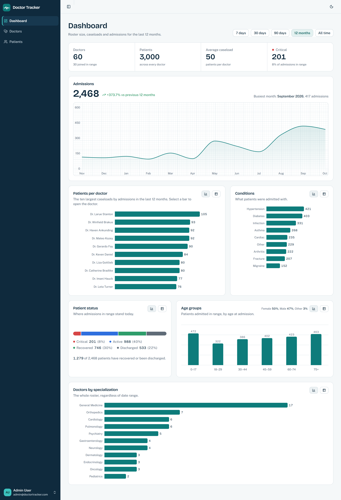

---

## Description

Hospitals juggle rosters of doctors and the hundreds of patients each one is responsible for, usually across spreadsheets that can't answer simple questions like _"who is overloaded?"_ or _"how many critical admissions did we have this quarter?"_. **Doctor Tracker** gives administrators one secure place to keep the doctor roster current, follow every patient from admission to discharge, and see at a glance where demand is growing — with fast search, rich filters and pagination over thousands of records, and a dashboard that turns the raw data into caseload, condition, status and admission-trend insights. This repository is the **Next.js frontend**; it talks to a standalone Express + MongoDB REST API.

## Features

- **Secure sign-in** — httpOnly-cookie session, route protection before any page renders, session-expiry handling, open-redirect-safe `?next=` return.
- **Dashboard** — headline figures, admissions trend drawn as a monitor trace, top-10 caseloads (click a bar to open the doctor), condition mix, patient status band, age groups with gender split, roster by specialization. Range presets from 7 days to all time; every chart has a **table view**.
- **Doctors** — debounced search (name or email), filters by specialization, hospital and date added, sorting, page sizes, create / edit / delete (with cascade warning when a doctor still has patients).
- **Doctor profile** — contact details, caseload status band, most common conditions, and their full patient list with add / remove patient.
- **Patients** — search, multi-select condition and status filters, doctor picker (server-searched), gender, age band and admission-date range filters; edit (including reassigning the doctor) and delete.
- **UX details** — URL-synced filters (shareable, back-button friendly), skeletons, empty and error states with retry, optimistic deletes with rollback, field-level server validation errors, toasts, light/dark theme, keyboard-accessible components, reduced-motion support, and a "waking the server" notice for free-tier cold starts.
- **Responsive** — collapsible sidebar on desktop, drawer navigation on mobile; tables become cards and filters move into a bottom sheet under 768 px.

## Tech stack

| Concern | Choice |
|---|---|
| Framework | **Next.js 16** (App Router, Cache Components / Partial Prerendering, `proxy.ts`) + React 19 |
| Language | TypeScript (strict) |
| UI | **Tailwind CSS 4** + **shadcn/ui** (Radix primitives), lucide icons, Bricolage Grotesque + Public Sans |
| Server state | **TanStack Query 5** |
| URL state | **nuqs** (type-safe search params) |
| Forms | react-hook-form + **Zod 4** (schemas mirror the API's) |
| Charts | Recharts 3 via shadcn charts (lazy-loaded) |
| Auth check | `jose` (JWT verification in the proxy) |

## Setup guide

**Prerequisites:** Node.js ≥ 20 and the [API](https://github.com/sadatnuman/doctor-tracker-backend) running locally (default `http://localhost:4000`) with demo data seeded.

```bash
# 1. Clone and install
git clone https://github.com/sadatnuman/doctor-tracker-frontend.git
cd doctor-tracker-frontend
npm install

# 2. Configure environment
cp .env.example .env.local
#    → API_URL     = where the API runs (http://localhost:4000)
#    → JWT_SECRET  = exactly the same value as the API's JWT_SECRET

# 3. Run
npm run dev                # http://localhost:3000
# or a production build
npm run build && npm start
```

### Environment variables

See [`.env.example`](./.env.example).

| Variable | Required | Description |
|---|---|---|
| `API_URL` | ✅ | Base URL of the Express API. `/api/*` is rewritten to `${API_URL}/api/*`. |
| `JWT_SECRET` | ✅ | Same secret as the API; lets `src/proxy.ts` verify the session cookie before rendering. |
| `NEXT_PUBLIC_DEMO_EMAIL` / `NEXT_PUBLIC_DEMO_PASSWORD` | | Optional. Shows a "Fill in demo credentials" helper on the sign-in page. |

### Scripts

| Command | What it does |
|---|---|
| `npm run dev` | Development server (Turbopack) |
| `npm run build` | Production build (type-checks, prerenders static shells) |
| `npm start` | Serve the production build |
| `npm run lint` | ESLint (Next.js core-web-vitals + TypeScript rules) |

## System architecture

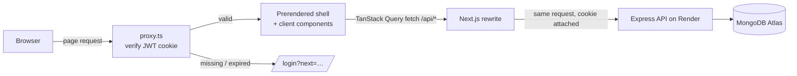

1. **Every page request** first hits `src/proxy.ts`, which verifies the httpOnly `dt_token` cookie (signature, issuer, expiry). No valid session → redirect to `/login?next=<page>`; already signed in on `/login` → redirect to the dashboard.
2. **Pages are static shells** prerendered at build time (Cache Components). Interactive parts are client components that read their state from the URL (nuqs) and their data through TanStack Query hooks.
3. **Data requests go to `/api/*` on the app's own origin.** `next.config.ts` rewrites them to the Express API, so the browser never talks to another domain and the auth cookie is first-party.
4. **Mutations** invalidate exactly the query families they affect (e.g. adding a patient refreshes patient lists, doctor counts and dashboard stats).

👉 The detailed design — rendering strategy, state model, data-fetching and caching rules, component architecture, performance techniques, accessibility and the design system — is in **[ARCHITECTURE.md](./ARCHITECTURE.md)**.

## Technical decisions

### 1. TanStack Query + URL state (nuqs) instead of Redux or Context

Almost all of this app's state is **server state** (doctors, patients, stats) plus **view state** (which page, which filters). Neither belongs in Redux or React Context:

- **Server state needs a cache, not a store.** With Redux every list would need hand-written loading/error/success actions, normalization, refetch-on-mutation logic and request de-duplication. TanStack Query provides those as defaults: one `useQuery` per resource keyed by its params, request de-duplication, `AbortSignal` cancellation when filters change mid-request, `placeholderData` that keeps the current page visible while the next loads (no flicker), and targeted invalidation through hierarchical keys (`['patients','list',params]`, `['doctors','detail',id]`, `['stats']`). Optimistic deletes snapshot every cached patient page and roll back if the request fails.
- **View state belongs in the URL.** Filters, search, sort and page live in search params via `nuqs`, with typed parsers (`parseAsInteger`, `parseAsArrayOf(parseAsStringLiteral(CONDITIONS))`, `parseAsIsoDate`). That makes every view **shareable and bookmarkable**, survives refresh, and makes the back button undo a filter change — none of which Context or Redux give you without extra syncing code.
- **Context re-render cost.** A Context holding filters re-renders every consumer on every keystroke. Here, the search box keeps keystrokes local and only commits to the URL after 300 ms of idle typing, so a list re-renders once per *search*, not once per *character*.

What remains is tiny UI state (which dialog is open), which lives in plain `useState` next to the component that owns it. Result: no global store at all, and less code.

### 2. httpOnly JWT cookie behind a same-origin rewrite instead of tokens in localStorage

The obvious SPA approach — keep the JWT in `localStorage` and send it as a header — has two problems: any injected script can read the token (XSS → account takeover), and the frontend server can't see the session, so protected pages would render first and redirect later.

Instead the API sets the JWT in an **`HttpOnly; Secure; SameSite=Lax`** cookie that JavaScript can't read. Because the frontend (Vercel) and the API (Render) are on different domains, a direct cross-site call would make that a **third-party cookie** — needing `SameSite=None`, which browsers increasingly block. So `next.config.ts` **rewrites `/api/*` to the API**: the browser only ever talks to the frontend's origin, the cookie is first-party, and no CORS preflights are needed.

Because the cookie arrives with every page request, `src/proxy.ts` can verify it (with `jose`, using the shared secret) **before** rendering, so users never see a flash of protected UI and get a clean redirect with a safe `?next=` return path. The API still verifies the token on every request — the proxy is the UX layer, the API is the security boundary. When a session expires mid-use, the API client catches the 401 and does a full navigation to `/login?expired=1`, which also drops every cached query from the old session.

## Visual evidence

### Desktop

| Sign in | Dashboard |
|---|---|
|  |  |

| Doctors | Doctor profile and patients |
|---|---|
| 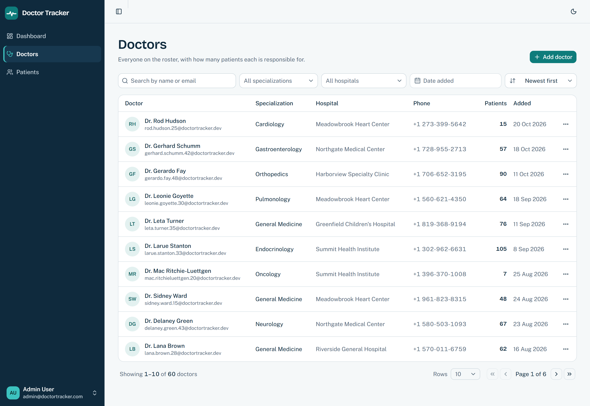 | 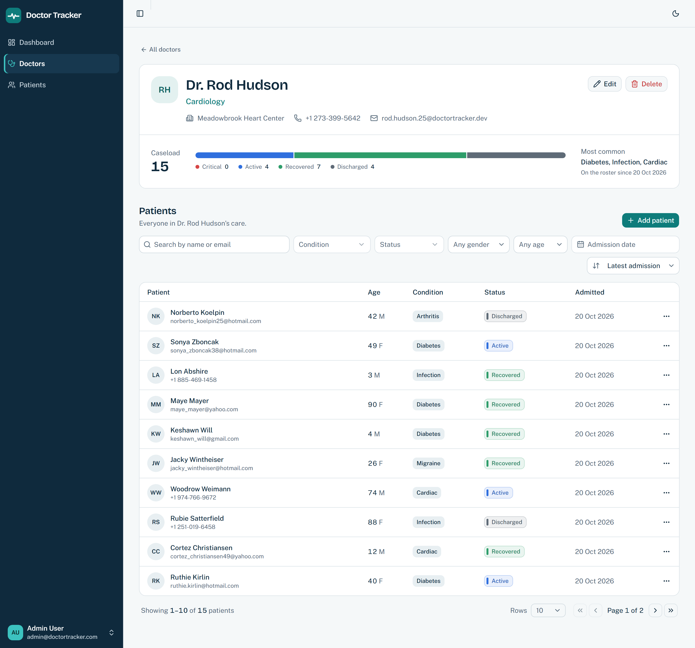 |

| Patients | Add patient |
|---|---|
| 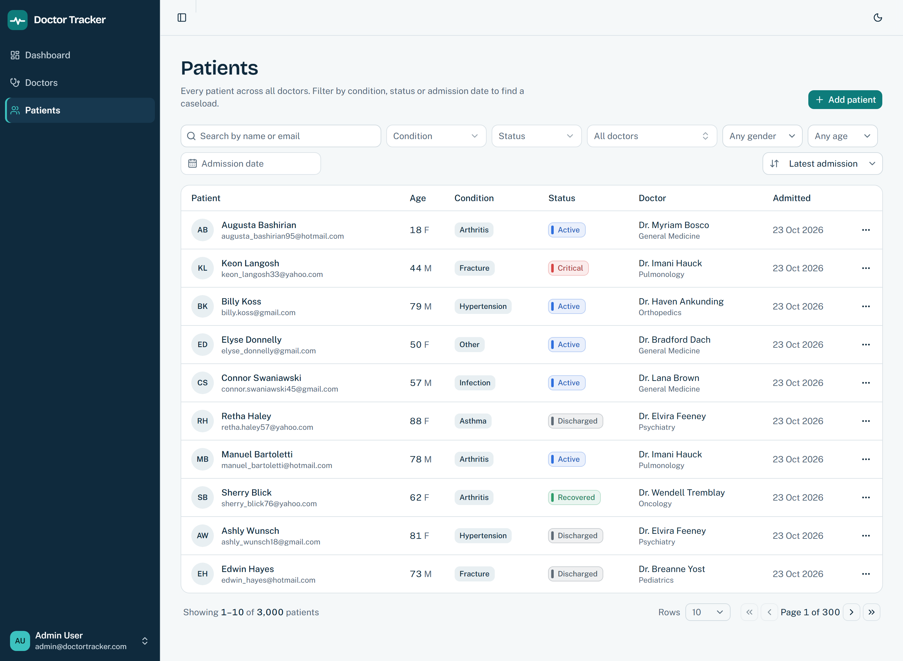 | 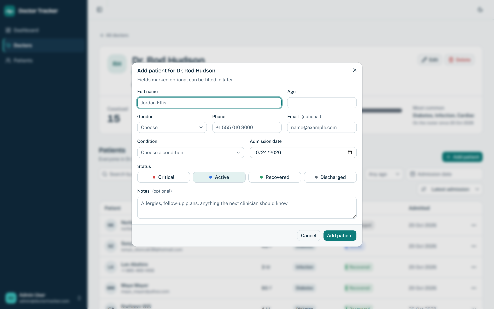 |

| Dark theme: dashboard | Dark theme: doctor profile |
|---|---|
| 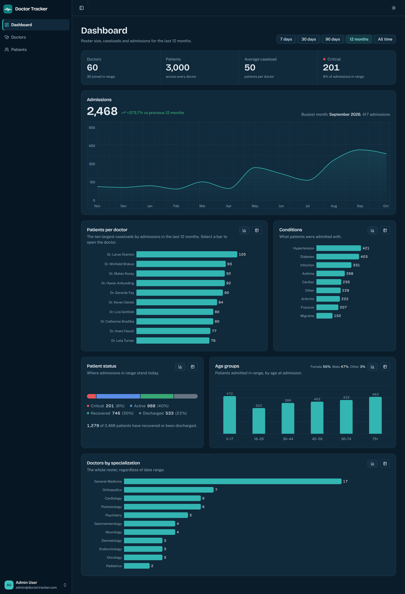 | 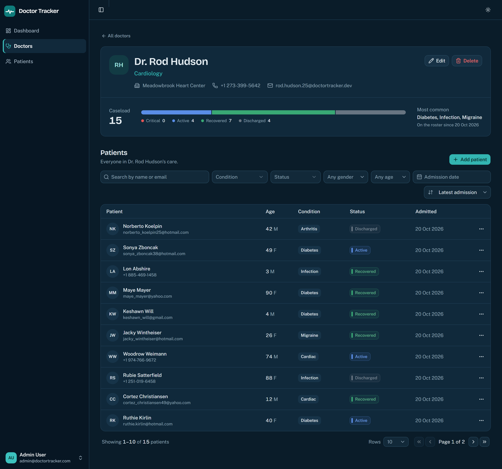 |

### Mobile

| Sign in | Dashboard | Doctors |
|---|---|---|
|  | 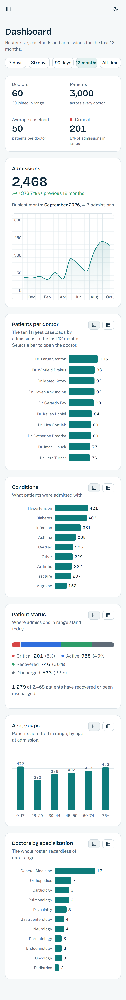 | 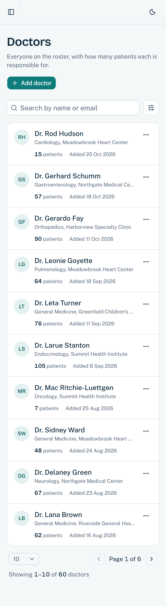 |

| Patients | Doctor profile | Add patient |
|---|---|---|
| 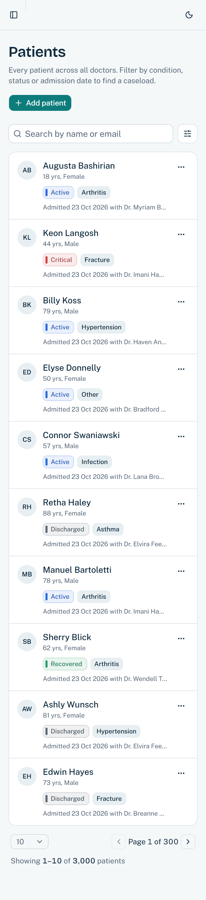 | 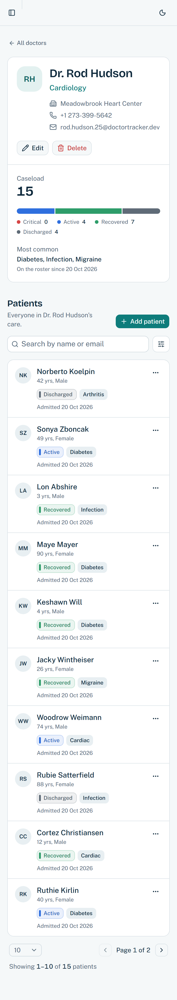 | 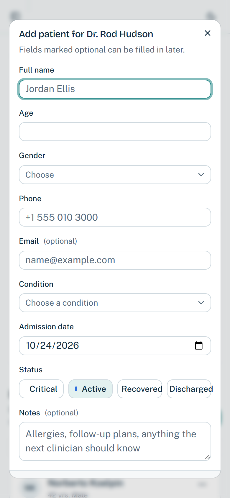 |

## Project structure

```
src/
├─ app/
│  ├─ (dashboard)/            authenticated area: layout (sidebar + header), error boundary
│  │  ├─ page.tsx             dashboard
│  │  ├─ doctors/             list + [id] profile
│  │  └─ patients/            list
│  ├─ login/                  sign-in page + form
│  ├─ layout.tsx              fonts, providers
│  ├─ globals.css             design tokens (light/dark), chart paper, trace animation
│  └─ not-found.tsx
├─ proxy.ts                   route protection (JWT verification)
├─ components/
│  ├─ ui/                     shadcn/ui primitives
│  ├─ layout/                 sidebar, header, user menu, cold-start notice
│  ├─ data/                   search input, filter bar, selects, date range, pagination, skeleton
│  ├─ common/                 page header, status badge/band, person cell, confirm dialog, states
│  ├─ doctors/                list view, profile, form dialog, picker, delete flow
│  ├─ patients/               shared patient list, form dialog
│  └─ dashboard/              dashboard view, chart panel, lazy-loaded charts
├─ hooks/                     data hooks (doctors, patients, overview, auth), media-query hooks
└─ lib/                       API client, query keys, URL params, validators, formatting, types
```

## Deployment

Deployed on **Vercel** from the `main` branch. Set `API_URL` (the Render URL) and `JWT_SECRET` (same as the API) in the Vercel project's environment variables; the optional demo variables show the credentials helper. The API's `CLIENT_ORIGIN` must be set to the Vercel URL.

## Branching

`develop` receives day-to-day work; changes reach `main` (production) through reviewed pull requests.
